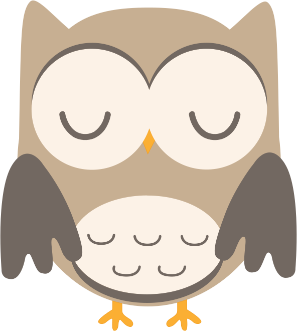
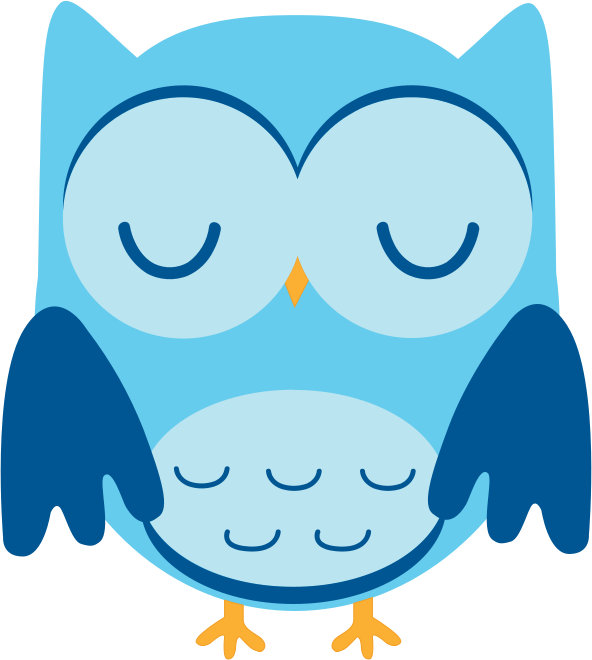
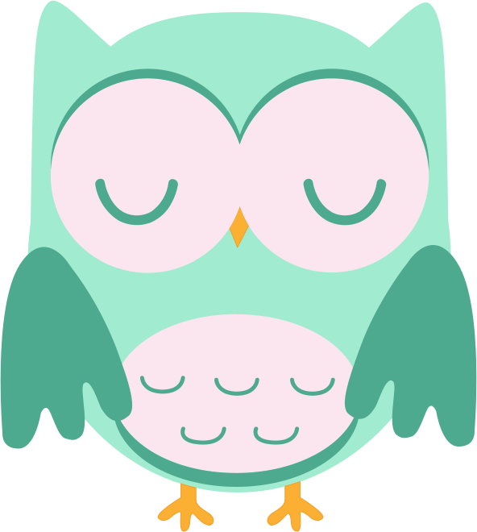
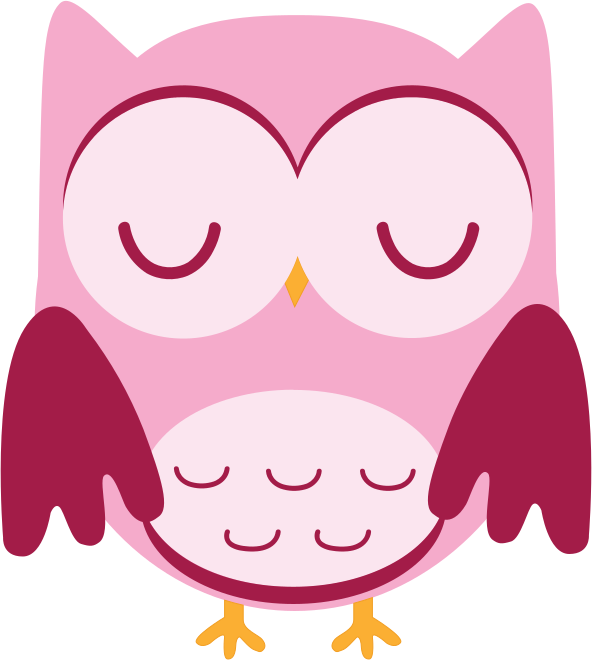
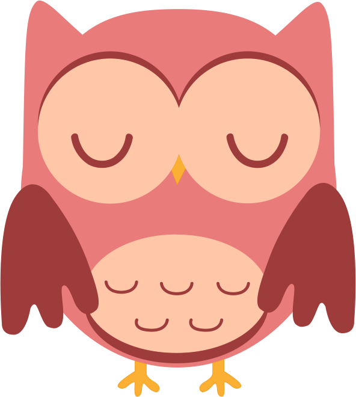

<div align="center">

# Sleepy Head Modal

**A friendly owl that dozes off when your visitors do.**

Sleepy Head shows a modal after someone has been inactive on your page for a set time.<br>
No dependencies, built on the native `<dialog>` element, and accessible out of the box.

[](https://github.com/SimonHayter/Sleepy-Head-Modal/releases/latest)
[](LICENSE)
[](#)

**[▶ Try the live demo](https://simonhayter.github.io/Sleepy-Head-Modal/)**

<table>
  <tr>
    <td align="center"><br><b>Brown</b></td>
    <td align="center"><br><b>Blue</b></td>
    <td align="center"><br><b>Mint</b></td>
    <td align="center"><br><b>Pink</b></td>
    <td align="center"><br><b>Sunset</b></td>
  </tr>
</table>

</div>

## Contents

- [Quick start](#quick-start)
- [Options](#options)
- [Controlling it from your code](#controlling-it-from-your-code)
- [Changing the wording](#changing-the-wording)
- [Theming](#theming)
- [Hosting the files yourself](#hosting-the-files-yourself)
- [Accessibility](#accessibility)
- [Browser support](#browser-support)
- [What's in the box](#whats-in-the-box)
- [License](#license)

## Quick start

Copy the three snippets below into your page. They load everything from the [jsDelivr](https://www.jsdelivr.com/) CDN, so there's nothing to download.

### 1. The CSS

Paste this inside your page's `<head>`:

```html
<!-- Sleepy Head: styles (inside <head>) -->
<link rel="stylesheet" href="https://cdn.jsdelivr.net/gh/SimonHayter/Sleepy-Head-Modal@1.0.1/dist/css/modal.css">
```

### 2. The HTML

Paste this just before your closing `</body>` tag:

```html
<!-- Sleepy Head: modal (just before </body>) -->
<dialog class="sleepy-head" data-sleepy-head aria-labelledby="sleepy-head-title" aria-describedby="sleepy-head-message">
  <div class="sleepy-head__panel">
    <header class="sleepy-head__header">
      <h2 class="sleepy-head__title" id="sleepy-head-title">Shh… the owl’s napping</h2>
      <form method="dialog">
        <button class="sleepy-head__close" value="close" aria-label="Close">
          <svg viewBox="0 0 16 16" width="16" height="16" aria-hidden="true" focusable="false">
            <path d="M3 3l10 10M13 3L3 13" stroke="currentColor" stroke-width="2.5" stroke-linecap="round" />
          </svg>
        </button>
      </form>
    </header>
    <div class="sleepy-head__body">
      <div class="sleepy-head__owl" aria-hidden="true">
        
        <span class="sleepy-head__zzz"><span>z</span><span>z</span><span>z</span></span>
      </div>
      <div class="sleepy-head__message" id="sleepy-head-message">
        <p>Nothing’s stirred for <span data-sleepy-head-duration>20 seconds</span>, so I took that as my cue for forty winks.</p>
        <p>Nudge me when you’re back. I’m a light sleeper, honest.</p>
      </div>
    </div>
    <form class="sleepy-head__actions" method="dialog">
      <button class="sleepy-head__wake" value="wake" autofocus>I’m back!</button>
    </form>
  </div>
</dialog>
```

### 3. The JavaScript

Paste this straight after the modal HTML, still before `</body>`. The first line loads the script and the second starts it:

```html
<!-- Sleepy Head: script (after the modal, before </body>) -->
<script type="module" src="https://cdn.jsdelivr.net/gh/SimonHayter/Sleepy-Head-Modal@1.0.1/dist/js/modal.js"></script>
<script type="module">
  sleepyHead({
    timeout: 20000, // milliseconds of inactivity before the owl nods off
    owl: 'brown',   // brown, blue, mint, pink or sunset
  });
</script>
```

That's it. Stop moving for 20 seconds and the owl will nod off.

> [!IMPORTANT]
> Keep `type="module"` on both script tags. It makes them run in order, so `sleepyHead()` is always ready when you call it.

> [!NOTE]
> JavaScript modules don't run when you open a page straight from your computer (`file:///…`). Preview it through a web server instead, for example by running `python -m http.server` in your site's folder and visiting <http://localhost:8000>.

## Options

All options are optional.

| Option | Default | What it does |
|---|---|---|
| `timeout` | `20000` | Milliseconds of inactivity before the modal opens. |
| `owl` | `'brown'` | Which owl to show: `brown`, `blue`, `mint`, `pink` or `sunset`. |
| `image` | `null` | The URL of your own image. Overrides `owl`. |
| `dialog` | `'[data-sleepy-head]'` | The `<dialog>` to use, as a selector or element. |
| `onSleep` | `null` | Function called when the modal opens. |
| `onWake` | `null` | Function called when the modal closes. |

Moving the mouse, touching the screen, scrolling or pressing a key all count as activity.

## Controlling it from your code

`sleepyHead()` returns a small controller:

```js
const owl = sleepyHead();

owl.open();      // show the modal now
owl.close();     // hide it
owl.reset();     // restart the inactivity timer
owl.remaining;   // milliseconds until the modal opens
owl.destroy();   // stop watching for inactivity
```

The dialog also fires events you can listen for:

```js
owl.dialog.addEventListener('sleepyhead:sleep', () => console.log('The owl fell asleep'));
owl.dialog.addEventListener('sleepyhead:wake', (event) => console.log('Woken by', event.detail.reason));
```

`event.detail.reason` is `'wake'` (the **I’m back!** button), `'close'` (the ✕ button) or `'dismiss'` (<kbd>Esc</kbd> or a click outside).

If your own code uses JavaScript modules, you can import it instead of using the global `sleepyHead`:

```js
import { sleepyHead } from 'https://cdn.jsdelivr.net/gh/SimonHayter/Sleepy-Head-Modal@1.0.1/dist/js/modal.js';
```

## Changing the wording

Edit the text in the HTML snippet however you like, including translating it. Whatever is inside `<span data-sleepy-head-duration>` gets replaced with how long the visitor has been away, and it counts up every second while the modal is open. It uses your page's `lang` attribute, so `<html lang="fr">` gives "20 secondes".

If the page has no Sleepy Head HTML, the script builds the modal for you with the default wording, so snippets 1 and 3 on their own are enough for a quick test.

## Theming

Override these custom properties in your own CSS:

```css
.sleepy-head {
  --sleepy-accent: #4f46e5;        /* button colour */
  --sleepy-accent-hover: #4338ca;  /* button hover colour */
  --sleepy-on-accent: #fff;        /* button text */
  --sleepy-surface: #fff;          /* modal background */
  --sleepy-panel: #f1f5f9;         /* message panel */
  --sleepy-text: #0f172a;          /* headings and main text */
  --sleepy-muted: #475569;         /* message text */
  --sleepy-focus: #6366f1;         /* keyboard focus outline */
  --sleepy-backdrop: rgb(0 0 0 / 0.55);
  --sleepy-radius: 0.75rem;
  --sleepy-font: Georgia, serif;
  --sleepy-duration: 0.35s;        /* open and close animation */
}
```

Dark mode is built in. To change its colours, set the same properties inside `@media (prefers-color-scheme: dark) { … }`.

## Hosting the files yourself

Prefer not to use a CDN? [Download the latest release](https://github.com/SimonHayter/Sleepy-Head-Modal/releases/latest), copy the `dist` folder into your site, and in the three snippets replace

```
https://cdn.jsdelivr.net/gh/SimonHayter/Sleepy-Head-Modal@1.0.1/dist/
```

with the path to your copy, for example `/dist/`. Keep `css`, `js` and `img` together inside `dist`, because the script finds the owls relative to its own location.

## Accessibility

- Built on the native `<dialog>`: keyboard focus moves into the modal, stays there while it's open, and goes back to where it was afterwards.
- Closes with the ✕ button, the **I’m back!** button, the <kbd>Esc</kbd> key or a click outside.
- Labelled for screen readers. The owl is marked as decorative.
- The counting-up time isn't announced every second, so screen readers aren't flooded.
- Colour contrast meets WCAG AA. Buttons are at least 44px for touch.
- Supports dark mode, reduced motion and Windows High Contrast.

## Browser support

All current versions of Chrome, Edge, Firefox and Safari.

## What's in the box

```
dist/                 Everything your site needs
├── css/modal.css
├── js/modal.js
└── img/              The five owls
demo/                 The demo page's own CSS and JavaScript
├── css/demo.css
└── js/demo.js
index.html            The demo page
src/sleepy-owls.ai    All the owl artwork in one Illustrator file
```

To run the demo locally, open a terminal in this folder, run `python -m http.server`, and visit <http://localhost:8000>.

## Contributing

Bug fixes and ideas are always welcome. [Open an issue](https://github.com/SimonHayter/Sleepy-Head-Modal/issues) or send a pull request.

## License

[MIT](LICENSE) © 2015-2026 Simon Hayter. The code and the owl artwork are free to use in personal and commercial projects.

<div align="center">

Made by [Simon Hayter](https://simonhayter.co.uk) · [About.me](https://about.me/simonhayter) · [Dribbble](https://dribbble.com/simonhayter) · [Twitter](https://twitter.com/simonhayteruk) · [GitHub](https://github.com/SimonHayter)

</div>
